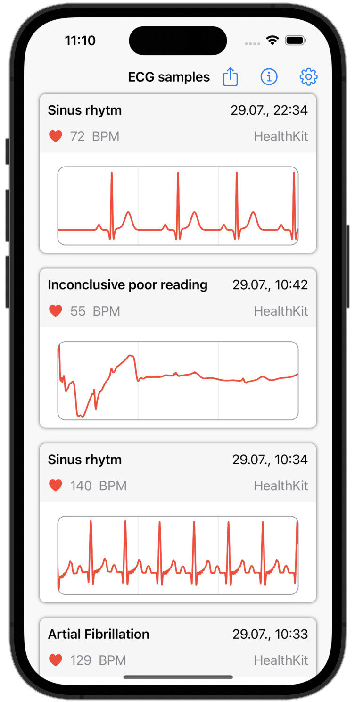
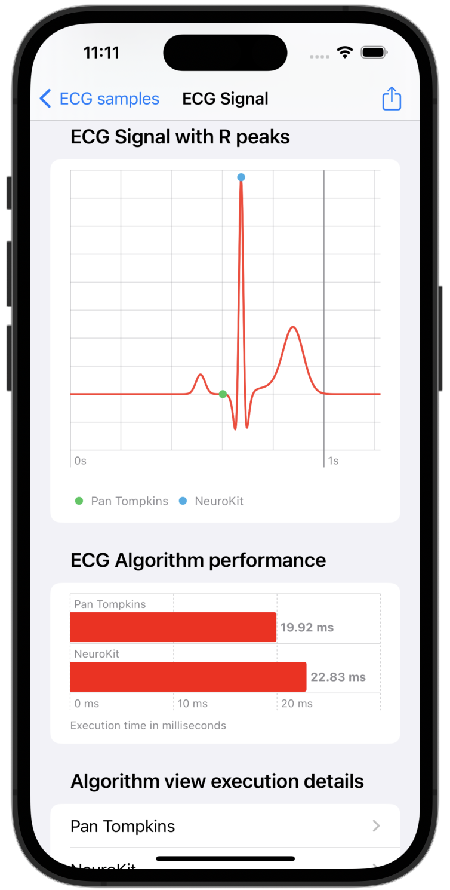
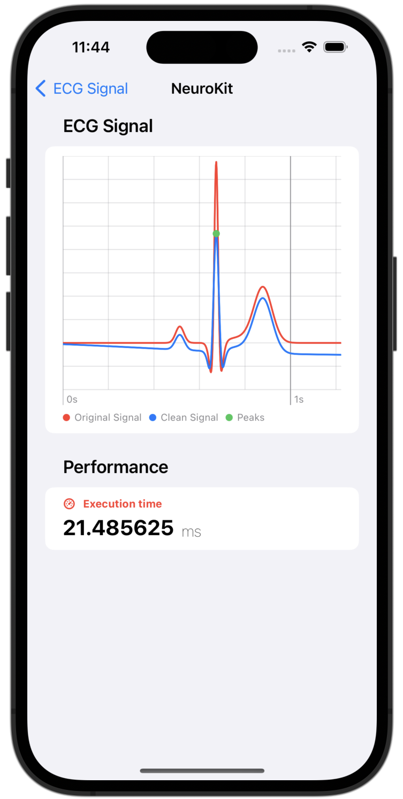
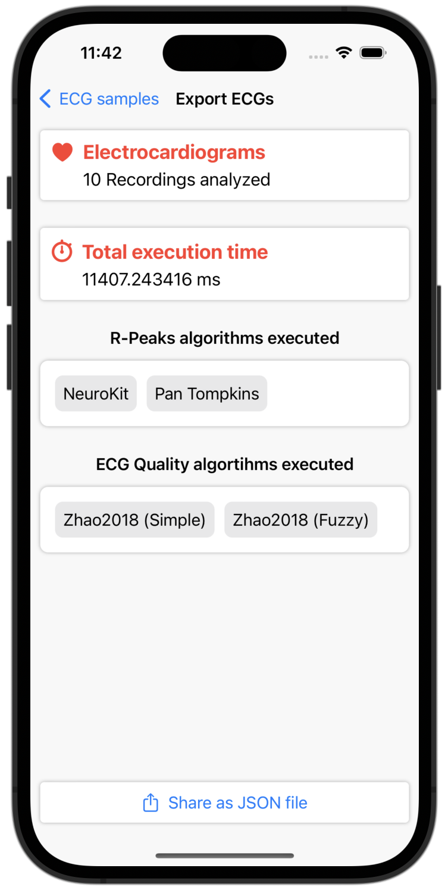

# PeakWatch

PeakWatch is a project to demonstrate, evaluate, and validate the functionality of the [PeakSwift](https://github.com/CardioKit/PeakSwift) package, which implements algorithms for cleaning up electrocardiogram (ECG) signals, detecting R-peaks, and evaluating signal quality. The associated application [PeakWatch](https://github.com/CardioKit/PeakWatch/src) takes advantage of all the features PeakSwift has to offer and presents this content in a visually appealing way. Calculations are performed using Apple's [HKElectrocardiogram](https://developer.apple.com/documentation/healthkit/hkelectrocardiogram) on the device. The results, including electrocardiogram signals, detected R-peaks, transit time, and signal quality, can be exported as a JSON file for further analysis. A [Jupyter notebook](https://github.com/CardioKit/PeakWatch/analysis) is provided for analysis of the data to provide insight into runtime, consistency of signal quality assessment, and accuracy of detected peaks compared to the established [NeuroKit](https://github.com/neuropsychology/NeuroKit) library.

## Features

- Demonstrates the functionality of PeakSwift's ECG signal processing and R-peak detection algorithms.
- Displays ECG data in an intuitive and visually appealing format.
- Utilizes Apple's HealthKit for on-device ECG signal analysis.
- Allows exporting of results, including ECG signals, detected R-peaks, runtime, and signal quality, as a JSON file.
- Includes a Jupyter notebook for in-depth data analysis and comparison with the NeuroKit library.

## Screenshots

<div style='float: center'>
  </img>
  </img>
  </img>
  </img>
</div>

## Installation

To install PeakWatch:

1. Clone this repository: `git clone https://github.com/CardioKit/PeakWatch.git`
2. Navigate to `src`
3. Open the project in Xcode.
4. Build and run on a simulator or device.

## Usage

Follow these steps to use PeakWatch:

1. Launch the app on your iOS device.
2. Provide necessary permissions for accessing HealthKit data.
3. Explore the ECG data, detected R-peaks, and signal quality presented by the app.
4. Export results as a JSON file for further analysis.

## Data Analysis

Use the provided Jupyter notebook to perform detailed data analysis:

1. Navigate to the `analysis` folder.
2. Open the Jupyter notebook file.
3. Follow the instructions within the notebook to analyze runtime, signal quality assessment consistency, and peak detection accuracy.

## Dependencies

PeakWatch relies on the following libraries:

- [PeakSwift](https://github.com/CardioKit/PeakSwift)
- [CSV.swift](https://github.com/yaslab/CSV.swift)

## Contributing

We welcome contributions to enhance PeakWatch:

1. Fork the repository.
2. Create a new branch: `git checkout -b feature/your-feature-name`
3. Commit your changes: `git commit -am 'Add some feature'`
4. Push to the branch: `git push origin feature/your-feature-name`
5. Create a pull request.

## How to cite?

If you are using parts of this work or build your experiments up on this repository please cite the following article:

```
@article{kapsecker2024peakswift,
    title = {PeakSwift: Mobile Detection of R-peaks in Single Lead Electrocardiograms},
    journal = {SoftwareX},
    volume = {25},
    pages = {101608},
    year = {2024},
    issn = {2352-7110},
    doi = {https://doi.org/10.1016/j.softx.2023.101608},
    url = {https://www.sciencedirect.com/science/article/pii/S2352711023003047},
    author = {Maximilian Kapsecker and Nikita Charushnikov and Leon Nissen and Stephan M. Jonas},
    keywords = {Electrocardiogram, R-peak detection, Swift, Benchmark}
}
```

## License

This project is licensed under the [Apache License 2.0](LICENSE).
